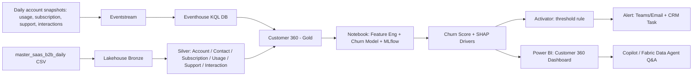

# Blueprint: Customer Intelligence Engine (Real-Time Churn Prediction & Retention)

**Team:** EPAM Fabricators (6 members)
**Use Case:** #4 – Customer Intelligence Engine (Advanced · Cloud & AI Platforms)
**Hackathon:** Accelerate Next Fabric Frontier (EPAM x Microsoft)
**Target industry:** B2B SaaS / subscription software
**Date submitted:** _TBD (deadline Oct 14, 2026)_

**Build execution update (October 29, 2026):** Use the [team build handbook](../build/README.md) and [day-by-day plan](../build/01_Day_by_Day_Plan.md) for the current implementation sequence, named ownership, beginner Power BI instructions, acceptance gates, and budget controls. These runbooks supersede older build recommendations below where they differ: start with a batch-first core, avoid unnecessary daily partitioning, label historical scored replay accurately, and measure rather than guarantee 90-day warning. Submission dates and sandbox expiry still require organizer confirmation.

---

## 1. Customer Problem

B2B SaaS providers typically discover churn **at renewal** — when the decision has already been made internally by the customer. By then it's too late to intervene. The signals that predict it (seat utilisation decay, falling API and feature usage, rising critical tickets, slower resolution times, a customer success manager who has gone quiet) already exist across disconnected systems (product telemetry, support desk, CRM, billing), but nobody correlates them into a single, continuously updated risk score.

**Target customer narrative:** A mid-size B2B SaaS provider ("NorthWave Cloud") loses roughly a quarter of its accounts over two years. Retention plays are reactive (triggered only once a cancellation notice arrives), arrive too late, and are not targeted — every at-risk account gets the same generic discount regardless of why it's at risk.

**Business question we answer:** *"Which accounts are likely to churn in the next 90 days, why, and what should we do about it — today, not at the renewal meeting?"*

---

## 2. Solution Overview

Build a **real-time Customer 360 + churn prediction + automated retention action** pipeline on Microsoft Fabric:

1. Stream account events (product usage, subscription changes, support tickets, CSM interactions) in near real time.
2. Maintain a unified, continuously updated Customer 360 profile per account.
3. Score churn risk with an explainable ML model on a true 90-day forward horizon, refreshed as new events arrive.
4. Automatically trigger a retention action (alert to the CS team / CRM task / targeted play) when risk crosses a threshold, with the top contributing drivers attached.
5. Expose everything through a Power BI dashboard and a natural-language Q&A layer for business users.

**Demo-ready proof (what we show the judges):** Replay a real account's recorded final months; watch its churn score climb day by day; an alert fires automatically with explainable drivers ("seat utilisation down 37%", "2 critical tickets open", "resolution time tripled", "21 days since last CSM touch"); a recommended retention play appears. Because the account's true `churn_date` is in the data, we can show the lead time on screen.

---

## 3. Architecture (Fabric-centric)

| Layer | Fabric / Azure Component | Purpose |
|---|---|---|
| Ingestion (real-time) | **Eventstream** | Replay the daily account snapshots forward in simulated time: usage, subscription, support, and interaction events |
| Ingestion (batch/historical) | **Data Factory / Lakehouse pipelines** | Load the 1.7 GB master CSV into OneLake Bronze |
| Real-time storage | **Eventhouse (KQL Database)** | Store/query streaming events, power real-time aggregations (rolling 7/30/90-day usage trends, ticket bursts) |
| Curated storage | **Lakehouse (OneLake, medallion: Bronze/Silver/Gold)** | Bronze = raw master file, Silver = shredded conformed entities, Gold = Customer 360 feature table |
| Feature engineering & ML | **Fabric Data Science notebooks (Spark) + MLflow** | Build trend features, train/track a gradient-boosting classifier, log experiments |
| Explainability | **SHAP (in notebook)** | Generate per-account top-driver explanations, stored alongside the score |
| Activation / alerting | **Activator (Reflex)** | Rule: churn_score > threshold → trigger alert (Teams/email webhook) + write retention task record |
| Consumption / BI | **Power BI (Direct Lake)** | Customer 360 dashboard, ARR-at-risk leaderboard, driver breakdown, retention action tracker |
| Conversational layer (stretch) | **Copilot in Power BI / Fabric Data Agent** | Let business users ask "which accounts are most at risk this week and why?" in plain English |
| Governance (stretch) | **Purview** | Lineage/sensitivity labeling on customer PII fields |

---

## 4. Data

**Dataset: purpose-built synthetic B2B SaaS, generated by `generate_master_csv.py`.**

We evaluated the public BigML telecom churn dataset first and **rejected it**. It is a single flat table of 3,333 rows with no timestamps, no entity relationships, and no event history. It cannot support a forward-looking 90-day label, a Customer 360 ontology, or a credible Eventhouse demonstration — the "real-time" story would have been theatre. It stays in `blueprint/archive/` as a reference benchmark only.

The generated master file is `output/master_saas_b2b_daily_10k_2y_2024.csv`:

| Property | Value |
|---|---|
| Grain | one row per `account_id` × `snapshot_date` |
| Accounts | 10,000 |
| Window | 730 daily snapshots, 2024-01-01 → 2025-12-30 |
| Rows | 6,669,117 (1.7 GB) |
| Columns | 41 |
| Churned accounts | 2,471 (24.7%) |
| Positive rows | 222,390 (3.33% have `label_churn_next_90d` = 1) |
| Pre-churn decay | starts 60–120 days before cancel date, sampled per account |

**Entity coverage (this is what makes the ontology real):**

- **Account** — `account_id`, `tenant_id`, `account_name`, `domain`, `industry`, `region`, `employee_count`, `created_date`, `arr_usd`, `csm_owner`
- **Contact** — `primary_contact_id`, `primary_contact_role`, `primary_contact_created_date`
- **Subscription** — `subscription_id`, `plan_tier`, `seats_purchased`, `mrr_usd`, `subscription_start_date`, `renewal_date`, `subscription_status`, `cancel_date`
- **Usage (daily)** — `active_users`, `sessions`, `feature_a/b/c_events`, `api_calls`, `licensed_seats`
- **Support** — `tickets_created_today`, `tickets_closed_today`, `critical_open_tickets`, `tickets_created_30d`, `avg_ttr_days_60d`
- **Interaction** — `interactions_30d`, `days_since_last_csm_touch`, `no_show_rate_90d`
- **Label** — `will_churn`, `churn_date`, `label_churn_next_90d`, `days_to_churn`

**Validated signal separation** (mean by `label_churn_next_90d`, full 6.67M rows). This is the evidence that the model has something real to learn:

| Signal | Label 0 | Label 1 | Δ |
|---|---|---|---|
| `active_users` | 69.59 | 43.86 | −37.0% |
| `sessions` | 199.81 | 124.34 | −37.8% |
| `api_calls` | 6499.11 | 4207.68 | −35.3% |
| `interactions_30d` | 6.00 | 3.80 | −36.6% |
| `critical_open_tickets` | 0.08 | 0.86 | +961% |
| `tickets_created_30d` | 11.03 | 21.43 | +94% |
| `avg_ttr_days_60d` | 1.80 | 5.46 | +203% |
| `days_since_last_csm_touch` | 13.00 | 19.67 | +51% |
| `no_show_rate_90d` | 0.04 | 0.24 | +467% |

**Integrity guarantees built into the generator:**
- Churned accounts stop emitting snapshots on their cancel date — no post-mortem rows to leak from.
- Every churner's cancel date is sampled late enough to leave a full 90-day labelable runway plus the degradation window.
- `label_churn_next_90d` was verified against `days_to_churn` across all 6,669,117 rows: **0 inconsistencies**.
- Seeded (`SEED = 42`) and chunked — re-runnable end to end in ~45 seconds.

**Data engineering tasks:**
- Land the master CSV into Bronze as-is, partitioned by `snapshot_date`.
- Silver: shred the denormalised file into the conformed entities above; cast types; encode categoricals (`industry`, `region`, `plan_tier`).
- Gold: Customer 360 feature table — raw features plus engineered trend features computed over the genuine history: `seat_utilisation = active_users / licensed_seats`, 7/30/90-day deltas and ratios on usage, `days_to_renewal`, ticket-burst flags, engagement-gap flags.
- **Split discipline:** out-of-time *and* out-of-account. Train on earlier dates for one account set; evaluate on later dates for accounts the model has never seen. Handle the 3.33% positive rate with class weights, and report PR-AUC — not accuracy.

---

## 5. Business Impact

- Detect at-risk accounts **up to 90 days before cancellation**, against a baseline process that reacts at the renewal meeting. The lead time is measurable, because every churned account in the data has a known `churn_date`.
- Enable **targeted** retention plays instead of blanket discounts — the driver mix tells you whether this is a product-adoption problem, a support problem, or a relationship problem.
- Rank by **ARR at risk** (`arr_usd` × probability), so finite CSM capacity goes where the revenue is.
- Give CS teams an **explainable** reason per alert, increasing play relevance and acceptance rate.
- Reusable accelerator: the same pattern (stream → 360 → explainable risk model → activation) generalizes to other "early warning" problems (expansion detection, credit risk, fraud, equipment failure).

---

## 6. Technical Excellence Highlights (for judges)

- **Dataset built for the problem, not bent to fit it** — we rejected the obvious public dataset on principle and generated a 6.67M-row longitudinal one that can actually carry a 90-day forward label. Seeded and re-runnable in ~45 seconds.
- Medallion architecture on OneLake with clear Bronze/Silver/Gold separation, and a real entity shred (Account/Contact/Subscription/Usage/Support/Interaction) rather than one wide table.
- Real-time (Eventstream/Eventhouse) + batch (Lakehouse) unified in one Customer 360 Gold table — hybrid architecture, not just batch ML.
- MLflow experiment tracking for reproducibility; SHAP for explainability (not a black box).
- **Leakage discipline we can defend out loud:** out-of-time *and* out-of-account holdout, no post-cancellation rows in the data, label integrity verified across all 6,669,117 rows with 0 inconsistencies.
- Event-driven activation (Activator) rather than a manual report — the system *acts*, not just reports.
- Enterprise-ready considerations: data lineage (Purview), PII handling, capacity/cost awareness.

---

## 7. Demo Script (for the pitch video)

Full script: `submission/Demo_Script.md`.

1. Show the business problem (30s): "NorthWave Cloud finds out at renewal, and by then the decision is made."
2. Show architecture diagram (30s).
3. Replay a real account's recorded final months → watch the churn score climb (60s).
4. Alert fires → show driver explanation + recommended play + **lead time vs. the true cancel date** (30s).
5. Power BI dashboard: portfolio view ranked by ARR at risk, ask a plain-English question via Copilot (30s).
6. Business impact recap + "what this becomes as a reusable accelerator" (30s).

---

## 8. Build Plan / Milestones

| Dates | Milestone |
|---|---|
| Oct 7–11 | Team finalized, account created, idea locked |
| Oct 13 | **Done** — synthetic SaaS B2B dataset generated and validated (6.67M rows, 0 label inconsistencies) |
| Oct 14 | Blueprint submitted (this document) |
| Oct 26 | Hackathon environment access unlocked |
| Oct 26–28 | Master CSV loaded to OneLake + Lakehouse medallion pipelines (Bronze → entity shred → Gold) built |
| Oct 28–30 | Eventstream/Eventhouse replay + Customer 360 Gold feature table with trend features |
| Oct 30–Nov 2 | Churn model training (MLflow) + SHAP explainability + out-of-time/out-of-account evaluation |
| Nov 2–4 | Activator alerting rules + Power BI dashboard (ARR-at-risk ranking, account history view) |
| Nov 4–5 | Copilot/Fabric Data Agent Q&A layer (stretch), polish, testing |
| Nov 6 | Pitch video submitted |
| Nov 30 | Hackathon showcase |

---

## 9. Open Questions / Risks

- Confirm Azure credit budget is sufficient for Eventhouse + continuous streaming during build phase (consider running stream in bursts, not 24/7).
- Confirm whether Fabric Data Agent / Copilot in Power BI is available in the provisioned capacity SKU.
- Entra ID app registrations / service principals needed for any webhook-based alerting must be requested early through mentors (per hackathon kickoff Q&A).
- **Scale:** 6.67M rows / 1.7 GB is comfortable for Spark but will not behave like a toy CSV. Partition Bronze by `snapshot_date`, and consider training on a stratified sample of account-days rather than all 6.67M rows — full-history inference is still available for the demo account.
- **Synthetic data honesty:** the dataset is generated, and we must say so in the first 30 seconds rather than be caught on it. The defence is strong and we should lead with it — no public churn dataset carries timestamped, multi-entity history, so a synthetic longitudinal dataset is the only way to make a 90-day forward label meaningful. The generator is seeded and re-runnable on stage.
- **Signal realism:** our degradation curves are clean by construction. Expect "is this too easy?" — answer with the out-of-time/out-of-account split, the 3.33% positive rate, PR-AUC rather than accuracy, and comparison to the naive usage-drop baseline. If the model scores near-perfect, say so plainly and attribute it to the synthetic generator rather than overclaiming production performance.
- **Class imbalance (3.33% positive rows)** — must report precision/recall/F1 and PR-AUC, plus alert volume at the chosen threshold. Accuracy is meaningless here.
- Large CSV sits in a OneDrive-synced folder locally; exclude `output/` from sync or keep it out of source control.

---

## 11. Winning Strategy (score-weighted priorities)

Judging weights: Business Value 25 · Solution Quality 25 · Technical Excellence 20 · Innovation 15 · Presentation 15.

| Priority | Action | Why it scores |
|---|---|---|
| 1 | Nail the **demo moment**: replay a real account's history → score climbs → alert fires → driver explanation → recommended play → **lead time shown against the true cancel date**, end-to-end, rehearsed until it never fails | Business Value + Solution Quality (50 pts combined) — judges remember the moment it *works live*, and the lead-time reveal is the proof the whole pitch rests on |
| 2 | Report **real model metrics** (precision/recall/F1/PR-AUC on an out-of-time, out-of-account holdout) and an honest baseline comparison (vs. "flag any account whose 30-day active-user trend drops >25%") | Solution Quality + Technical Excellence — shows rigor, not a toy |
| 3 | Use **SHAP explainability** per alert — "seat utilisation down 37%, two critical tickets open, resolution time tripled", not just a score | Technical Excellence + Innovation — explainability is the differentiator vs. generic churn demos |
| 4 | Tie every architecture choice back to a **dollar impact** (ARR at risk = `arr_usd` × probability, summed across alerted accounts × expected save rate, assumptions labelled) | Business Value — judges explicitly score against "meaningful customer problem" |
| 5 | Keep scope **tight and working** over broad and broken — Eventstream/Eventhouse + model + Activator + Power BI is already enough; treat Copilot/Fabric Data Agent Q&A as stretch, cut first if time runs short | Solution Quality — a smaller solution that works beats a bigger one that doesn't |
| 6 | Presentation: tell it as a **customer pitch**, not a tech demo — problem → "watch this" live moment → impact number → "here's why this is enterprise-ready" (governance/lineage mention) | Presentation 15 pts + Innovation 15 pts |
| 7 | Lead with the **dataset decision** — "we rejected the obvious public dataset because it cannot support a 90-day forward label, and built one that can" | Innovation + Technical Excellence — turns the biggest potential objection into a credibility moment |

**Fastest path to a working v1 (do this first, polish later):**
1. Load `output/master_saas_b2b_daily_10k_2y_2024.csv` to Lakehouse Bronze, partitioned by `snapshot_date`.
2. Build the Gold feature table with trend features; take a stratified sample of account-days for training speed.
3. Train one solid model (LightGBM/XGBoost, plus a logistic-regression baseline) in a notebook, log to MLflow, compute SHAP values.
4. Score the holdout, pick a threshold by alert budget, generate a ranked "accounts at risk" table with top-3 drivers and ARR at risk — this alone is a legitimate demo before streaming/Activator are wired up.
5. Layer in Eventstream/Activator/Power BI as time allows — these add polish and "wow"; the model + explainability + lead-time proof is the credibility core.

---

## 10. Team

| Name | Role |
|---|---|
| _TBD_ | Team Lead / Fabric architecture |
| _TBD_ | Data engineering (ingestion, Lakehouse, medallion) |
| _TBD_ | Data science (churn model, MLflow, SHAP) |
| _TBD_ | Real-time/Activator + Power BI |
| _TBD_ | Power BI / Copilot + storytelling |
| _TBD_ | Pitch/demo video + business narrative |
