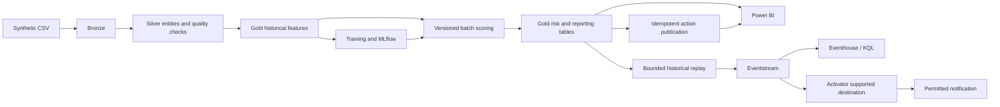

# Customer Intelligence Engine: team build handbook

Prepared October 29, 2026. This is an execution plan, not evidence that the cloud solution has already been implemented.

## Start here

Build an explainable retention decision system: identify risk, explain the evidence, recommend an action, and demonstrate that the action reaches its owner.

The existing dataset is synthetic. Historical daily snapshots are replayed; they are not production events. The initial replay uses real model outputs calculated in advance, not live inference. State these boundaries in the presentation.

1. Everyone reads this page and [shared contracts](./02_Shared_Contracts_and_Acceptance.md).
2. Somnath confirms the proposed developer assignments below with the team today.
3. Each person opens their role runbook below.
4. Follow [the daily execution board](./01_Day_by_Day_Plan.md).
5. Post evidence at every handoff, not just "done."

## Six owners

| Person | Primary ownership | Runbook |
|---|---|---|
| Somnath Roy | Team lead, platform, integration, cost, release | [Somnath](./03_Somnath_Roy_Lead.md) |
| Archi S | Business analyst, acceptance testing, value model, presentation | [Archi](./04_Archi_S_Business_Analyst.md) |
| Ashish (Developer 1) | Data engineering, quality, Customer 360 | [Ashish](./05_Ashish_Data_Engineering.md) |
| Irfan (Developer 2) | ML, evaluation, scoring, explanations | [Irfan](./06_Irfan_ML_and_Explainability.md) |
| Lokesh (Developer 3) | Power BI semantic model, reports, RLS | [Lokesh: beginner Power BI guide](./07_Lokesh_Power_BI_Beginner.md) |
| Sujith (Developer 4) | Eventstream, Eventhouse, replay, activation | [Sujith](./08_Sujith_Replay_and_Activation.md) |

No Power BI experience is assumed. Developer 3 uses the browser first; no Windows machine is required for the recommended path.

These are proposed skill-based workstream assignments, not a claim about anyone's existing experience. Somnath may swap owners before kickoff; update this mapping and the role runbook together.

## What we will deliver

### Must have

- Validated source ingestion and typed Silver entities.
- Customer 360 account-day features, including trailing behavior changes.
- Baseline and one explainable classifier with saved held-out evaluation.
- Account risk and transparent business segments.
- Three-page Power BI report with historical as-of selection.
- Model-scored historical replay, threshold action, and notification evidence.
- Action tracking, idempotency tests, and explicit failure visibility.
- Implemented access controls and clearly separated planned controls.
- Architecture addendum, demo recording, reproducible notebooks, and exports.

### Stretch, only after the core is stable

- Permitted Copilot/Data Agent Q&A.
- Grounded AI-written account summaries.
- A custom action-update UI.
- Incremental inference during replay.

No Azure OpenAI, VM, custom website, paid Power Automate feature, or larger capacity is a prerequisite. Do not spend money to decorate an unfinished core.

## Scope and timeline

The working target is November 6, taken from the existing blueprint. Somnath must confirm the actual deadline, video duration, submission format, and sandbox expiry with organizers on October 29. If the deadline differs, change the dates together; do not skip validation.

| Gate | Date | Evidence required |
|---|---|---|
| G0 | Oct 29 | Capacity/access verified; contracts and ownership accepted |
| G1 | Oct 31 | Real features -> model score -> Power BI, not fixtures |
| G2 | Nov 2 | Real scored replay -> Eventhouse -> action/notification |
| G3 | Nov 4 | Two consecutive clean end-to-end runs; feature freeze |
| G4 | Nov 5 | Rehearsal, backup recording, exported deliverables |
| Submit | Nov 6, subject to confirmation | Upload early and retain receipt |

## Working architecture

The action record and delivery receipt are different things. Do not mark a notification "Sent" merely because an action row exists. The first release may create deterministic action records in the scoring/publication job while Activator sends notifications. Label that separation; it is not a CRM integration.

## Collaboration rules

1. One owner edits each notebook/item. Reviewers send changes to its owner.
2. Do not share a single user password among six people. Request named sandbox identities or organizer-approved access.
3. F2 is shared compute. Authoring can be parallel; heavy jobs use booked windows.
4. Feature/table changes require agreement from the producer and consumers.
5. Fixtures are labeled `is_fixture=true` and never used as evaluation evidence.
6. Store operational time in UTC and show historical dates separately.
7. Fail visibly on missing tables, invalid schemas, stale scoring, or delivery errors.
8. Use one versioned reporting release. Never mix scores from multiple model versions.
9. Keep secrets out of notebooks, screenshots, exports, and source control.
10. Export work outside the expiring sandbox before the final day.

## First two hours on October 29

| Time | Lead | Other members |
|---|---|---|
| 0-30 min | Check capacity, identities, workspace, expiry | Read contracts; record assumptions/questions |
| 30-60 min | Assign owners; approve names and access | Dev 1 starts upload; Dev 2 designs split; Dev 3 opens browser report guide; Dev 4 checks capabilities; Archi defines acceptance |
| 60-120 min | Create run ordering and compute booking | Each owner produces one small demonstrable result, using fixtures if dependencies are not ready |

## Budget and compute

- Use the assigned F2 capacity; do not provision duplicates.
- Check actual and forecast spend daily; cost data may lag.
- Stop notebook Spark sessions when finished.
- Pause a dedicated capacity only after coordinating with all users.
- Pausing affects availability and can settle smoothed compute charges; storage can still cost money.
- Stop/deactivate streaming paths after a rehearsal, not just the replay sender.
- Keep a shared booking: preparation -> training -> replay/integration.
- At 50% budget consumption, review remaining work. At 75%, suspend optional experiments and preserve rehearsal capacity. These are team guardrails, not Azure-enforced guarantees.

## Evidence and sources

Keep actual artifacts in an approved shared repository/storage location; these instructions do not prescribe uploading private data to public services.

Official references, verified where linked during preparation:

- [Create Fabric capacity](https://learn.microsoft.com/en-us/fabric/enterprise/buy-capacity)
- [Pause/resume capacity](https://learn.microsoft.com/en-us/fabric/enterprise/pause-resume)
- [Lakehouse ingestion options](https://learn.microsoft.com/en-us/fabric/data-engineering/load-data-lakehouse)
- [Create a Lakehouse](https://learn.microsoft.com/en-us/fabric/data-engineering/tutorial-build-lakehouse)
- [Create Direct Lake semantic models](https://learn.microsoft.com/en-us/fabric/fundamentals/direct-lake-develop)
- [Eventstream custom endpoint](https://learn.microsoft.com/en-us/fabric/real-time-intelligence/event-streams/add-source-custom-app)
- [Activator introduction](https://learn.microsoft.com/en-us/fabric/real-time-intelligence/data-activator/activator-introduction)

Fabric menus, previews, licenses, and tenant permissions can differ. When a capability is absent, record the exact blocker and use the explicit fallback in the role guide. Never present a fallback as the missing capability.
